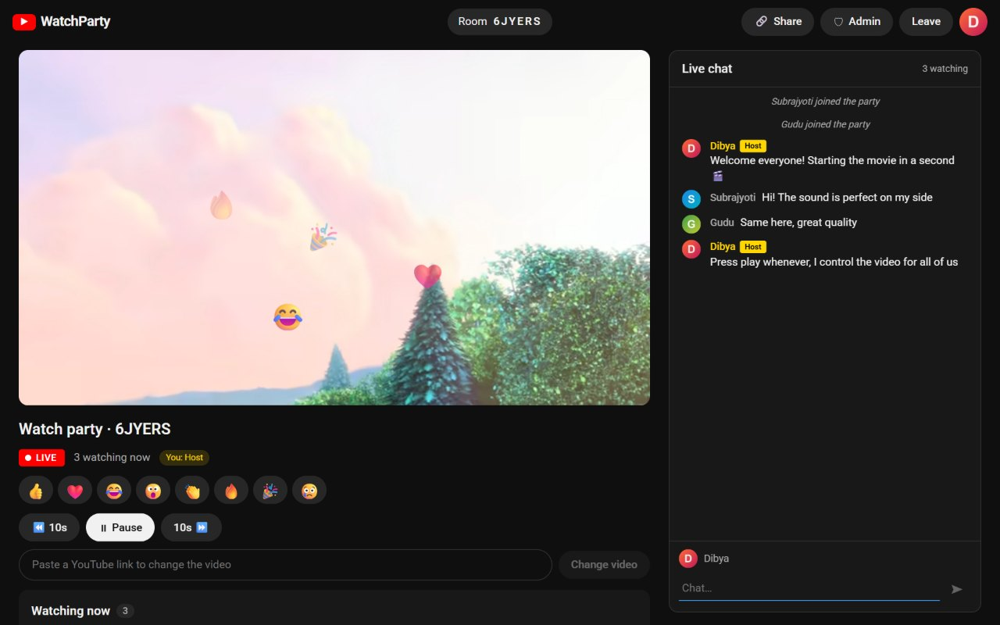
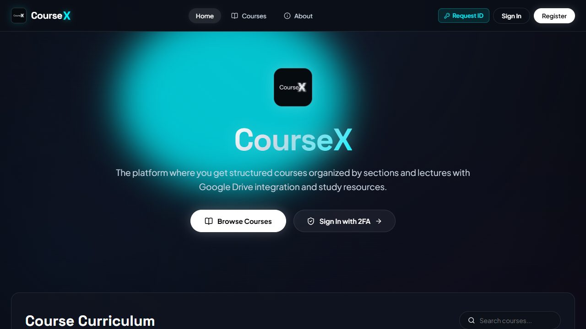
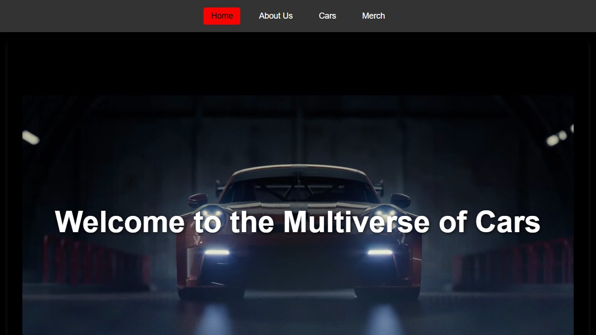
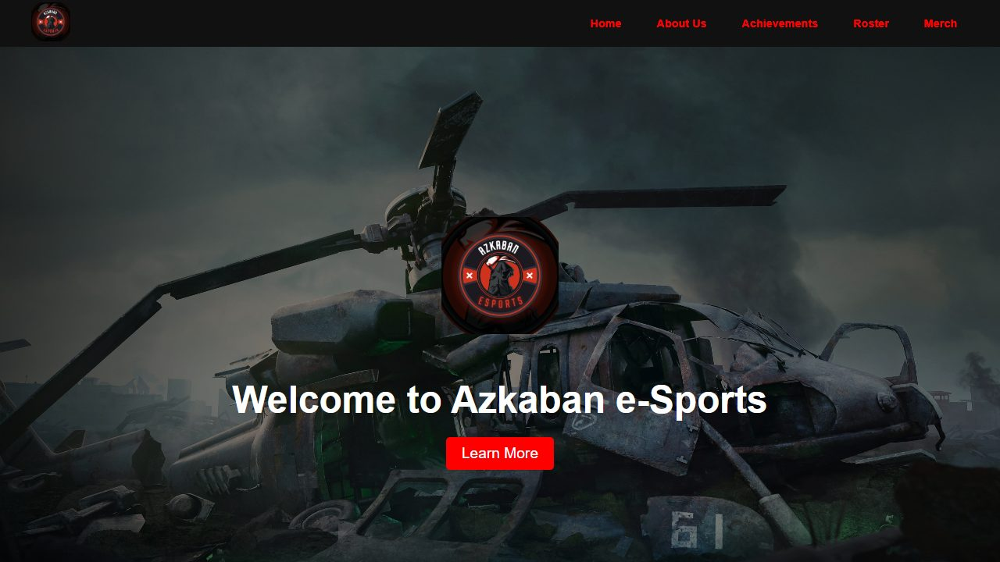
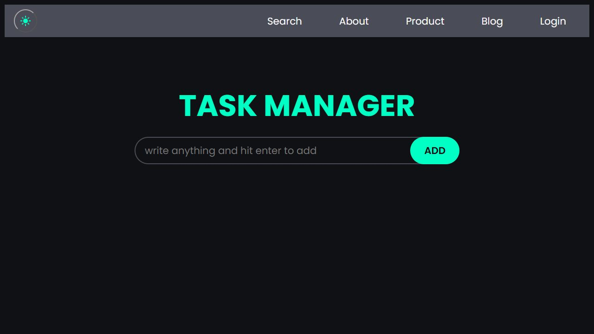

  
  
  
  

## 👋 About me

> *"Just a silly coder, chasing semicolons."*

I'm **Dibyajyoti Pradhan** (Dibya), a Computer Science student from **Bhubaneswar** with a strong interest in **web development** and **game-related projects**. I enjoy turning ideas into functional, visually appealing digital experiences, from a dark-themed learning platform to an esports website to a real-time watch-party app.

I also have a creative side: photography and video. It shows up in projects like **TheStoryteller** (a photography portfolio with its own CMS) and **The Filmox** (a cinematography studio website).

| 🧭 At a glance | |
| :-- | :-- |
| 🔭 **Building** | **CourseX**, a cloud-integrated learning platform (React + Vite) |
| 🚀 **Latest project** | **YouTube Watch Party**, a real-time app (React + Express + Socket.IO), [live demo below](#-featured-project) |
| 🌱 **Learning** | Node.js, Express and WebSockets, plus Data Structures & Algorithms in Python |
| 🎯 **Looking for** | Internship opportunities in full-stack / web development |
| 💬 **Ask me about** | Web development, React, Git & GitHub, UI design |

 

## 🧰 Tech stack

**Languages** 

**Frontend** 

**Backend & databases** 

**Tools & deployment** 

**Creative tools** 

**Currently exploring** 

 

## 🚀 Featured project

### 🎬 YouTube Watch Party

Watch YouTube together, perfectly in sync. Create a room, share the link, and everyone's player follows the host's play, pause and seek in real time. Built as a full-stack assignment and deployed on Render.

- 🔄 **Real-time sync** over WebSockets (Socket.IO). Late joiners land on the right second.
- 👑 **Roles:** Host, Moderator and Viewer, with permissions enforced on the server.
- ✋ **Request & approval flow**, an admin panel, live chat and emoji reactions.
- 🧪 **52 automated tests** and a YouTube-style dark UI, responsive on phones.

  
  
  
  
  
  

[**▶ Live demo**](https://youtube-watch-party-dloc.onrender.com) &nbsp;·&nbsp; [**Source code & full write-up**](https://github.com/gravityyyy99/youtube-watch-party)

 

## 🗂️ More projects

<table>
  <tr>
    <td width="50%" valign="top" align="center">
      
       <b>CourseX</b>
       Structured online courses with Google Drive integration, search, cart and a dark glass UI.
       <code>React</code> · <code>Vite</code> · <code>Cloudflare</code>
       <a href="https://coursex.pradhandj07.workers.dev/">Live</a> · <a href="https://github.com/gravityyyy99/CourseX">Code</a>
    </td>
    <td width="50%" valign="top" align="center">
      
       <b>Car-Khana</b>
       A premium car showcase site: luxury, sports and F1 categories, plus a merch store.
       <code>HTML</code> · <code>CSS</code> · <code>JavaScript</code>
       <a href="https://car-khana.netlify.app/">Live</a> · <a href="https://github.com/gravityyyy99/Car-Khana">Code</a>
    </td>
  </tr>
  <tr>
    <td width="50%" valign="top" align="center">
      
       <b>AZKABAN e-Sports</b>
       A responsive esports organisation website with rosters, the org story and achievements.
       <code>React</code> · <code>Vite</code> · <code>CSS</code>
       <a href="https://azkaban-e-sports.netlify.app/">Live</a> · <a href="https://github.com/gravityyyy99/AZKABAN-e-Sports">Code</a>
    </td>
    <td width="50%" valign="top" align="center">
      
       <b>Task Manager</b>
       A clean task manager with a dark theme: type a task, hit enter, done.
       <code>HTML</code> · <code>CSS</code> · <code>JavaScript</code>
       <a href="https://task-maneger-alpha.vercel.app">Live</a> · <a href="https://github.com/gravityyyy99/Cohort-3-A-7">Code</a>
    </td>
  </tr>
</table>

**And more on GitHub:**

- 📸 [**TheStoryteller**](https://github.com/gravityyyy99/thestoryteller-website): photography portfolio with its own CMS (React and Firebase)
- 🎞️ [**The Filmox**](https://github.com/gravityyyy99/The-Filmox): cinematography studio website (Next.js)
- 💰 [**FinTrack Pro**](https://github.com/gravityyyy99/FinTrack-Pro-Personal-Finance-Tracker): personal finance tracker
- 🔐 [**Random Password Generator**](https://github.com/gravityyyy99/Random-Password-Generator)
- 🧮 [**DSA**](https://github.com/gravityyyy99/DSA): data structures and algorithms practice in Python

 

## 📊 GitHub stats

  

<picture>
  <source media="(prefers-color-scheme: dark)" srcset="https://raw.githubusercontent.com/gravityyyy99/Gravityyyy99/output/github-contribution-grid-snake-dark.svg">
  <source media="(prefers-color-scheme: light)" srcset="https://raw.githubusercontent.com/gravityyyy99/Gravityyyy99/output/github-contribution-grid-snake.svg">
  
</picture>

 

## 🤝 Let's connect

I'm always happy to talk about web development, projects and internship opportunities.

  
  
  
  
  
  

Thanks for stopping by ✨ &nbsp;|&nbsp; Stats refresh automatically every day

