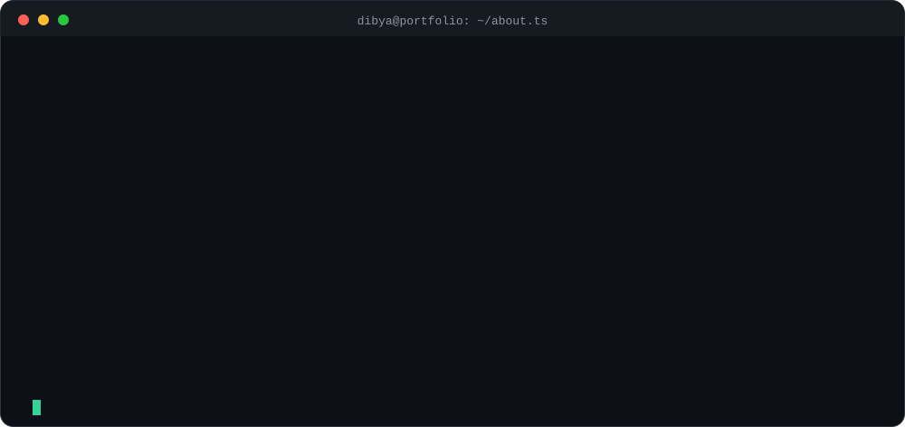
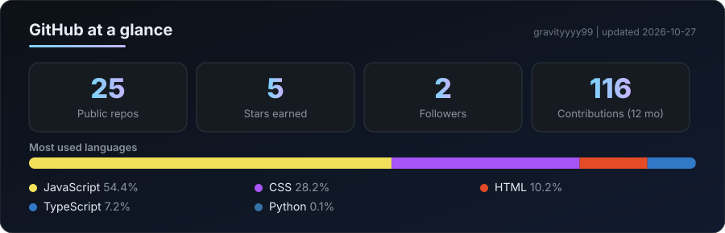

  
  
  

 

## 🛰️ Tech stack, in orbit

 

**Languages** (TypeScript: still learning) 

**Frontend** 

**Databases** (Firebase: some) 

**Tools & deployment** 

**Creative tools** 

 

## 🏅 Certifications

 

## 🧭 Journey

 

## 📊 GitHub stats

  

<picture>
  <source media="(prefers-color-scheme: dark)" srcset="https://raw.githubusercontent.com/gravityyyy99/Gravityyyy99/output/github-contribution-grid-snake-dark.svg">
  <source media="(prefers-color-scheme: light)" srcset="https://raw.githubusercontent.com/gravityyyy99/Gravityyyy99/output/github-contribution-grid-snake.svg">
  
</picture>

 

## 🤝 Let's connect

  
  
  
  
  
  

