<!-- Every card is an animated SVG drawn by scripts/render_cards.py and refreshed daily by
     .github/workflows/update-cards.yml. Keep this block free of blank lines and keep each row's
     images on one line with no spaces between them: the spacing is baked into the SVGs. -->

 
 
 
 
 
 
 
 
 
 
 
 
 
 
 

